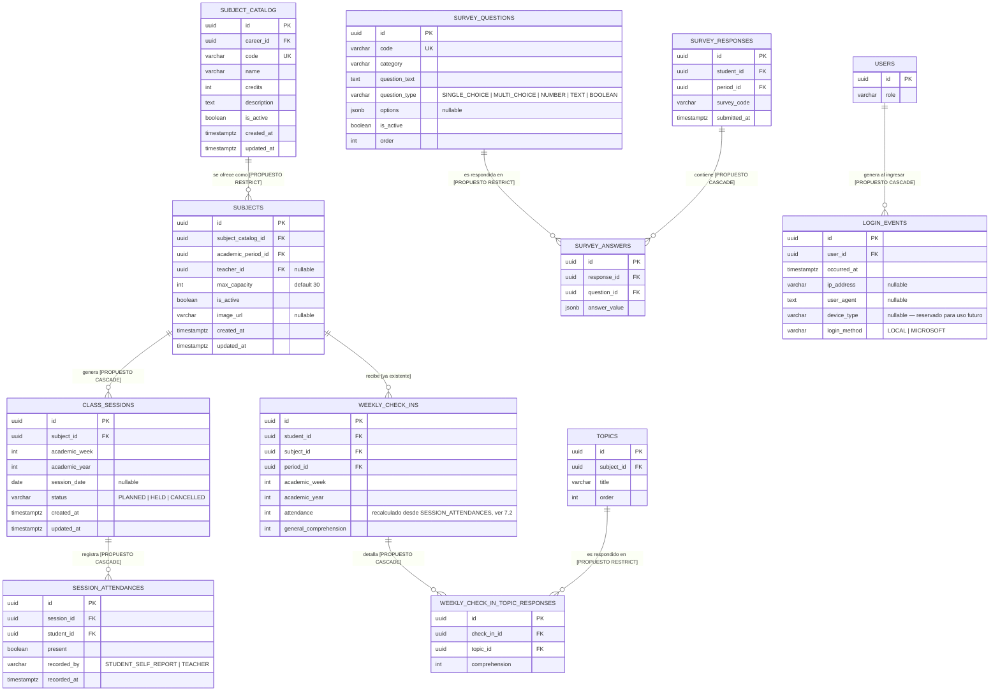

# Plan de actualización de la base de datos — modelo académico, asistencia, encuestas y acceso

> **Documento histórico.** Describe MentoraPredict cuando era un sistema universitario (facultades, carreras, créditos, escala 0–20). Esa estructura se retiró en la conversión a sistema de gestión escolar; el estado vigente está en [docs/erp-escolar/10-estado-de-implementacion.md](../erp-escolar/10-estado-de-implementacion.md).

> **Estado: diseño aprobado (ver §9), pendiente de plan de ejecución por fases. Nada de lo descrito acá está implementado todavía.** Este documento es la continuación del análisis comparativo contra `SIGLA-Backend` (`D:\UCE\Semestre VII\Arquitectura de Software\Proyectos\SIGLA-Backend\docs\backend\database-model.md`) sobre facultades/carreras/períodos, asistencia y encuestas, más un quinto punto (registro de acceso a la plataforma) agregado sobre la marcha. Sigue el mismo formato que el documento de SIGLA (objetivos, convención de traducción, diagrama, modelo por dominio, restricciones). Las 4 preguntas abiertas de la versión anterior ya fueron resueltas (§9) — lo que sigue es convertir esto en fases ejecutables (mismo formato que el plan Fase 0-6 ya cerrado), implementarlo con checkpoint por fase, y **solo al final** actualizar `entity-relationship-diagram.md`, `database-architecture.md` y `business-logic.md` para reflejar el estado real.

## 1. Objetivo del documento y por qué estos cuatro cambios, y no otros

El objetivo real del proyecto — confirmado por `business-logic.md` y `dropout-prediction-proposal.md` — es predecir riesgo académico por estudiante a partir de señales objetivas (notas, cumplimiento, asistencia, tendencia) más un componente de IA que recomienda acciones. Cada uno de los cuatro cambios de este plan existe porque **debilita o bloquea directamente esa función central**, no porque "esté bien tenerlo":

| Cambio propuesto | Por qué le importa al objetivo del proyecto |
|---|---|
| Separar catálogo de materia vs. oferta por período | `analytics-service`/`prediction-service` ya calculan tendencia *entre períodos* (`CalculateTrendUseCase`) y `dropout-prediction-proposal.md` depende explícitamente de eso para predecir abandono institucional. Hoy `subjects` solo puede existir en **un** período para siempre — la función de tendencia multi-período no tiene con qué trabajar en cuanto exista un segundo período real. |
| Asistencia real, basada en sesiones del período | La asistencia es un insumo directo de `ClassifyRiskUseCase` (RF-018, el corazón del sistema). Hoy es un número que el propio estudiante escribe, sin ningún anclaje a cuántas semanas tiene realmente el período ni a si hubo clase esa semana — el insumo más importante del riesgo es, hoy, el menos verificable de todos. |
| Normalizar la encuesta de comprensión por tema | Alimenta el mismo `weekly_check_in` que ya usa `general_comprehension` como señal de riesgo. Hoy vive en un `jsonb` sin integridad referencial — no se puede confiar en que un `topicId` exista o pertenezca a la materia correcta, y no se puede consultar tendencia por tema sin parsear JSON a mano. |
| Encuesta socioeconómica expandible | `dropout-prediction-proposal.md` §6 ya la nombra como el gap real para que la predicción de abandono institucional (no solo de una materia) sea seria: *"socioeconomic status, scholarship/financial-aid standing, employment... would be a genuine scope expansion."* No es una idea nueva de este documento, es cerrar un gap ya documentado. |
| Registro de acceso a la plataforma | Frecuencia/regularidad de uso es en sí misma una señal de riesgo temprano (un estudiante que deja de entrar suele dejar de reportar check-ins antes de que sus notas lo reflejen). Hoy no existe ningún registro de cuándo un usuario entra — ni para detectar desenganche, ni para auditoría de seguridad básica. |

Es decir: este plan no es "mejorar la base de datos por prolijidad" — es cerrar cuatro puntos donde la estructura actual le resta confiabilidad a la predicción de riesgo, que es la razón de ser de MentoraPredict.

## 2. Alcance

**Dentro de alcance**: `academic-service` (dueño de 4 de las 5 áreas), `auth-service` (dueño del registro de acceso, §5.5), y el impacto que cada una tiene en los consumidores reales que ya existen (`analytics-service` lee `weekly_check_ins.attendance`/`general_comprehension` para clasificar riesgo; ese contrato de lectura se preserva, ver §7.2/§7.3).

**Fuera de alcance de este documento** (decisiones que quedan para después de que se apruebe el diseño, no bloquean la aprobación):
- Usar los nuevos datos (asistencia real, encuesta socioeconómica) *dentro* del cálculo de riesgo de `analytics-service` — este documento diseña dónde vive el dato, no cómo se pondera. Eso es un cambio de `ClassifyRiskUseCase` para un momento posterior.
- `auth-service`/`user-service`/`prediction-service` no tienen cambios de esquema propios en este plan.
- El punto de Facultad/Carrera/Período (§7.1) es el de mayor radio de impacto — se presenta con dos opciones y una recomendación, no como un hecho consumado, porque requiere tu decisión explícita antes de tocar código (ver §9).

## 3. Convención de traducción de atributos y tablas

Igual que en `database-model.md` de SIGLA: la documentación de negocio se mantiene legible en español, la implementación real (tablas, columnas, entidades TypeORM) va en inglés, `snake_case` en Postgres / `camelCase` en TypeScript. Esta tabla cubre únicamente los conceptos **nuevos** de este documento — los ya existentes (`Facultad`→`faculties`, etc.) ya están traducidos en `database-architecture.md`.

| Concepto en español | Nombre técnico (TS) | Tabla sugerida (Postgres) |
|---|---|---|
| Catálogo de materia (existe una vez, independiente del período) | `SubjectCatalog` | `subject_catalog` |
| Oferta de una materia en un período concreto | *(reinterpretación de la tabla `subjects` ya existente)* | `subjects` |
| Sesión de clase de una materia en una semana del período | `ClassSession` | `class_sessions` |
| Registro de asistencia de un estudiante a una sesión | `SessionAttendance` | `session_attendances` |
| Respuesta de comprensión por tema del sílabo | `WeeklyCheckInTopicResponse` | `weekly_check_in_topic_responses` |
| Pregunta de una encuesta (catálogo, expandible) | `SurveyQuestion` | `survey_questions` |
| Instancia de encuesta respondida por un estudiante | `SurveyResponse` | `survey_responses` |
| Respuesta individual a una pregunta de encuesta | `SurveyAnswer` | `survey_answers` |
| Registro de acceso a la plataforma | `LoginEvent` | `login_events` |

| Atributo en español | Atributo TS | Columna Postgres |
|---|---|---|
| código de materia | `code` | `code` |
| créditos | `credits` | `credits` |
| semana académica | `academicWeek` | `academic_week` |
| fecha de la sesión | `sessionDate` | `session_date` |
| presente / ausente | `present` | `present` |
| registrado por (autorreporte o docente) | `recordedBy` | `recorded_by` |
| nivel de comprensión | `comprehension` | `comprehension` |
| código de la pregunta | `questionCode` | `code` |
| tipo de pregunta | `questionType` | `question_type` |
| opciones de respuesta | `options` | `options` |
| valor de la respuesta | `answerValue` | `answer_value` |
| categoría de encuesta | `category` | `category` |
| momento del ingreso | `occurredAt` | `occurred_at` |
| dirección IP | `ipAddress` | `ip_address` |
| agente de usuario (navegador/app) | `userAgent` | `user_agent` |
| tipo de dispositivo | `deviceType` | `device_type` |
| método de acceso | `loginMethod` | `login_method` |

## 4. Diagrama general (las 4 áreas juntas)

*(Se omiten en este diagrama las FK hacia `academic_user_references`/`careers`/`academic_periods` ya existentes, para no repetir lo que ya está en `entity-relationship-diagram.md` — acá el foco es lo nuevo.)*

## 5. Por área

### 5.1 Catálogo de materia vs. oferta por período

**El hallazgo** (ya presentado, se repite acá por completitud del plan): `subjects.academic_period_id` es `NOT NULL` y `subjects.code` es `UNIQUE` global — una materia solo puede existir en un único período, para siempre. Verificado contra la base real: los 19 `subjects` apuntan al mismo período (2026-A, el único que ha existido). No hay ninguna prueba de qué pasa al crear un segundo período porque nunca ha ocurrido.

**Decisión (confirmada en §9): Opción B — separar catálogo y oferta ahora.** Radio de impacto contenido: todo lo que hoy referencia `subjects.id` (`enrollments`, `evaluations`, `grades`, `topics`, `weekly_check_ins`, `subject_teachers`, las nuevas `class_sessions`) **sigue apuntando a `subjects.id` sin cambios** — porque `subjects` sigue siendo la fila period-scoped (la "oferta"), solo que ahora `code`/`name`/`credits`/`description`/`career_id` se mueven a la nueva `subject_catalog`, y `subjects` gana `subject_catalog_id FK`. Ningún consumidor de `subjects.id` se entera del cambio.

| Tabla | Columna | Antes | Después |
|---|---|---|---|
| `subject_catalog` (nueva) | `code`, `name`, `credits`, `description`, `career_id` | — | Se mudan acá desde `subjects`, `UNIQUE(code)` se mantiene acá |
| `subjects` | `subject_catalog_id` | — | Nueva FK `RESTRICT` hacia `subject_catalog` |
| `subjects` | `academic_period_id`, `teacher_id`, `max_capacity`, `image_url`, `is_active` | — | Se quedan igual — son atributos de la oferta, no del catálogo |
| `subjects` | `UNIQUE(subject_catalog_id, academic_period_id)` | no existe | Nueva — evita ofertar la misma materia dos veces en el mismo período |

Migración: `subject_catalog` se puebla desde los 19 `subjects` actuales (una fila catálogo por cada oferta actual, ya que solo hay un período), luego `subjects` pierde las 5 columnas migradas y gana la FK. Reversible, sin pérdida de datos, sin tocar ninguna otra tabla.

### 5.2 Asistencia basada en la duración real del período

**Decisión (confirmada en §9): Nivel 2 — sesiones reales por materia, incluyendo registro docente de asistencia** (no solo autorreporte del estudiante; ambos caminos quedan construidos desde el principio, no diferido).

- `class_sessions`: una fila por `(subject, academic_week, academic_year)`, generada automáticamente para cada `subject` cuando su `academic_period` pasa a `ACTIVE` (cubriendo todas las semanas entre `start_date` y `end_date`). `status` empieza en `PLANNED`; el docente la pasa a `HELD` o `CANCELLED`.
- `session_attendances`: una fila por `(session, student)`, con `present` boolean y `recorded_by` (`STUDENT_SELF_REPORT` o `TEACHER`). Se construye el flujo completo para ambos: el estudiante puede autorreportar su asistencia semanal (como hoy), y el docente puede registrar/corregir la asistencia real de su materia — un nuevo endpoint interno para que el docente marque asistencia por sesión (`POST /api/v1/academic/subjects/:id/sessions/:sessionId/attendance`, batch por estudiante). Regla de negocio a definir en la fase de ejecución: si el docente y el estudiante reportan valores distintos para la misma sesión, ¿cuál prevalece? (recomendado: el registro docente prevalece por ser la fuente más confiable, el autorreporte queda como señal secundaria/de respaldo cuando no hay registro docente).
- `weekly_check_ins.attendance` **se mantiene** como columna (no se elimina — `analytics-service` ya la lee), pero pasa a ser un valor **recalculado** desde `session_attendances` en el momento del upsert del check-in, en vez de un número que el estudiante escribe directamente. El contrato de lectura hacia `analytics-service` no cambia — solo cambia de dónde sale el número.

### 5.3 Encuesta de comprensión por tema — normalización

`weekly_check_in_topic_responses`: una fila por `(check_in, topic)` en vez de un `jsonb` suelto. `topic_id` con FK real hacia `topics` (`RESTRICT` — un tema con respuestas no se puede borrar, coherente con el resto del modelo). La regla "el tema debe pertenecer a la materia del check-in" se valida en aplicación (mismo criterio que ya usa el resto del proyecto para reglas cruzadas — no hace falta un trigger). `weekly_check_ins.topic_responses` (jsonb) se retira después de migrar los datos históricos existentes a la tabla nueva.

### 5.4 Encuesta socioeconómica expandible

`survey_questions` (catálogo — agregar una pregunta nueva es una fila nueva, no una migración) + `survey_responses` + `survey_answers` (una fila por pregunta respondida). Diseñado para que el mismo motor sirva a futuro para cualquier encuesta nueva (`category` distingue `SOCIOECONOMIC` de lo que venga después) — incluida, si se decide más adelante, una migración de la encuesta de comprensión de §5.3 a este mismo mecanismo, aunque eso no es parte de este plan.

**Decisión (confirmada en §9): repetible, por período y más de una vez dentro del mismo período.** La idea explícita es que MentoraPredict vaya entendiendo la situación del estudiante de forma progresiva — no es un formulario de una sola vez. Por eso `survey_responses` lleva `period_id` (para poder comparar cómo cambian las respuestas entre períodos) y **deliberadamente no tiene ningún `UNIQUE` que limite cuántas veces un estudiante puede responder** — cada envío es una fila nueva, con su propio `submitted_at`. Es una tabla de historial/línea de tiempo, no un estado único por estudiante. Esto tiene una implicación directa para quien consuma estos datos más adelante: siempre hay que pedir "la respuesta más reciente por pregunta" (`MAX(submitted_at)` agrupado), nunca asumir una sola fila por estudiante.

### 5.5 Registro de acceso a la plataforma (nuevo, `auth-service`)

A diferencia de las otras 4 áreas, esta vive en `auth-service` — es donde ocurre el login real, y `users.id` ya es la fuente de la verdad ahí mismo (no hace falta ninguna tabla de referencia cross-servicio, es FK directa a `users`).

`login_events`: una fila por cada inicio de sesión exitoso (`LoginUserUseCase` y `OAuthLoginUseCase` — ambos flujos, no solo el local). Diseño mínimo real + extensible para lo que pediste dejar listo a futuro:

| Columna | Tipo | Estado |
|---|---|---|
| `user_id` | FK → `users.id` | Real, obligatoria |
| `occurred_at` | `timestamptz` | Real, obligatoria — fecha y hora exacta del ingreso |
| `login_method` | `varchar`, `CHECK IN ('LOCAL','MICROSOFT')` | Real, obligatoria — cuál de los dos flujos se usó |
| `ip_address` | `varchar(45)` nullable | Real — `LoginUserUseCase.execute(dto, ip)` ya recibe `ip` hoy (se usa para el rate-limit de intentos fallidos); solo hace falta persistirlo, no hay plumbing nuevo que construir |
| `user_agent` | `text` nullable | Real — ya disponible en el controller vía `req.headers['user-agent']`, mismo patrón que `ip` |
| `device_type` | `varchar(20)` nullable | **Reservada, no poblada todavía** — esto es lo que pediste "dejar listo a futuro". La columna existe desde ya para no requerir otra migración cuando se construya la detección real (parseo de `user_agent`, o un valor explícito que mande el cliente móvil/web); hasta entonces queda `NULL` en todas las filas. |

`OAuthLoginUseCase.execute(profile)` hoy no recibe `ip`/`req` — es la única pieza de plumbing nueva de esta área (pasarlo desde el controller, igual que ya se hace en el login local).

No se limita a estudiantes: se registra cualquier login (`STUDENT`/`TEACHER`/`ADMIN`), porque es el mismo flujo para los tres roles y no tiene sentido bifurcarlo — quien consuma esto para "entender la situación del estudiante" simplemente filtra por rol al consultar, igual que ya hacen `academic_user_references`/`analytics_user_references` con el campo `role`.

## 6. Restricciones de integridad — consolidado

| Tabla | Restricción | Detalle |
|---|---|---|
| `subject_catalog` | `UNIQUE(code)` | Migrado desde `subjects.code` |
| `subjects` | `FK subject_catalog_id → subject_catalog.id` | `RESTRICT` |
| `subjects` | `UNIQUE(subject_catalog_id, academic_period_id)` | Nueva — evita doble oferta en el mismo período |
| `class_sessions` | `FK subject_id → subjects.id` | `CASCADE` — las sesiones no tienen sentido sin su materia-oferta |
| `class_sessions` | `UNIQUE(subject_id, academic_week, academic_year)` | Una sesión por materia por semana |
| `class_sessions` | `CHECK status IN ('PLANNED','HELD','CANCELLED')` | |
| `session_attendances` | `FK session_id → class_sessions.id` | `CASCADE` |
| `session_attendances` | `FK student_id → academic_user_references.id` | `RESTRICT` (mismo patrón ya usado en `weekly_check_ins`) |
| `session_attendances` | `UNIQUE(session_id, student_id)` | Un registro de asistencia por estudiante por sesión |
| `session_attendances` | `CHECK recorded_by IN ('STUDENT_SELF_REPORT','TEACHER')` | |
| `weekly_check_in_topic_responses` | `FK check_in_id → weekly_check_ins.id` | `CASCADE` |
| `weekly_check_in_topic_responses` | `FK topic_id → topics.id` | `RESTRICT` |
| `weekly_check_in_topic_responses` | `UNIQUE(check_in_id, topic_id)` | |
| `weekly_check_in_topic_responses` | `CHECK comprehension BETWEEN 0 AND 100` | |
| `survey_questions` | `UNIQUE(code)` | |
| `survey_questions` | `CHECK question_type IN ('SINGLE_CHOICE','MULTI_CHOICE','NUMBER','TEXT','BOOLEAN')` | |
| `survey_responses` | `FK student_id → academic_user_references.id` | `RESTRICT` |
| `survey_responses` | `FK period_id → academic_periods.id` | `RESTRICT` — FK directa (no cross-servicio: las encuestas viven en `academic-service`, igual que `academic_periods`). Sin `UNIQUE` sobre `(student_id, period_id)`: se permite más de una respuesta por período, a propósito (§5.4) |
| `survey_answers` | `FK response_id → survey_responses.id` | `CASCADE` |
| `survey_answers` | `FK question_id → survey_questions.id` | `RESTRICT` |
| `survey_answers` | `UNIQUE(response_id, question_id)` | Una respuesta por pregunta dentro de la misma instancia de envío |
| `login_events` | `FK user_id → users.id` | `CASCADE` — FK directa, sin tabla de referencia (misma base física, mismo servicio) |
| `login_events` | `CHECK login_method IN ('LOCAL','MICROSOFT')` | |
| `login_events` | `CHECK device_type IS NULL OR device_type IN (...)` | Valores concretos a definir cuando se construya la detección real (§5.5) — hasta entonces la columna acepta `NULL` únicamente |

## 7. Impacto por servicio

| Servicio | Impacto |
|---|---|
| `academic-service` | Dueño de las 8 tablas nuevas/modificadas. 5 nuevas entidades TypeORM (`SubjectCatalog`, `ClassSession`, `SessionAttendance`, `WeeklyCheckInTopicResponse`, `SurveyQuestion`/`SurveyResponse`/`SurveyAnswer`), migración de datos de `subjects`→`subject_catalog` y de `topic_responses` jsonb→tabla, nuevos endpoints (registrar asistencia por sesión, responder encuesta). |
| `analytics-service` | **Sin cambio de contrato inmediato** — sigue leyendo `weekly_check_ins.attendance`/`general_comprehension` igual que hoy (§5.2). Cuando se decida usar la encuesta socioeconómica o el detalle por tema en el cálculo de riesgo, eso es un cambio de `ClassifyRiskUseCase` fuera de alcance de este documento (§2). |
| `prediction-service` | Sin cambios. Posible consumidor futuro de la encuesta socioeconómica para el modelo de abandono institucional (`dropout-prediction-proposal.md`), no en este plan. |
| `auth-service` | Dueño de `login_events` (§5.5). Nueva entidad TypeORM, nuevo hook en `LoginUserUseCase`/`OAuthLoginUseCase`, threading de `ip`/`user-agent` hacia el caso de uso OAuth (hoy solo el login local los recibe). |
| `user-service` | Sin cambios. |

## 8. Plan de fases sugerido

Reutiliza la misma metodología ya probada en la Fase 4 de este proyecto (migración generada contra la base real, verificada con `migration:generate` en diff cero, backfill antes de cualquier FK que dependa de datos existentes):

1. **Fase A** — `subject_catalog` (si se aprueba §5.1 opción B): migración de datos primero (backfill desde `subjects`), luego la FK.
2. **Fase B** — `class_sessions`/`session_attendances` (Nivel 2 de asistencia): generación de sesiones para el período `ACTIVE` actual antes de habilitar el flujo de registro.
3. **Fase C** — `weekly_check_in_topic_responses`: migrar el `jsonb` histórico a filas, verificar conteos coincidan, recién ahí retirar la columna `jsonb`.
4. **Fase D** — `survey_questions`/`survey_responses`/`survey_answers`: no requiere backfill (no hay datos históricos de esto).
5. **Fase E** — `login_events` en `auth-service`: sin backfill posible (no hay historial de logins pasados que reconstruir), la tabla arranca vacía y se llena desde el primer login posterior al despliegue.

Ninguna fase es prerequisito de otra — A, B, C, D y E son completamente independientes entre sí y pueden aprobarse/ejecutarse en cualquier orden.

## 9. Decisiones confirmadas

1. **§5.1** — **Opción B**: separar `subject_catalog` (materia) de `subjects` (oferta por período).
2. **§5.2** — **Nivel 2**, con registro de asistencia tanto por autorreporte del estudiante como por el docente (no diferido) — pendiente de definir, en la fase de ejecución, la regla de precedencia cuando ambos reportan valores distintos para la misma sesión.
3. **§5.4** — `survey_responses` **repetible por período y más de una vez dentro del mismo período** — lleva `period_id`, sin `UNIQUE` que limite reenvíos, porque la idea del proyecto es entender la situación del estudiante de forma progresiva, no capturarla una sola vez.
4. **Nuevo, agregado sobre la marcha**: §5.5, registro de fecha/hora de acceso a la plataforma (`login_events`), con columna `device_type` reservada (sin poblar) para cuando se construya detección real de dispositivo.

Las 5 áreas se aprueban juntas — quedan listas para pasar a un plan de ejecución por fases.

## 10. Próximos pasos

Con las decisiones de §9 ya tomadas, el siguiente paso es transformar este diseño en un plan de ejecución por fases (mismo formato que el plan Fase 0-6 ya cerrado: una fase por área — A/B/C/D/E de §8 —, cada una con su propio checkpoint de aprobación antes de tocar código). Voy a entrar en modo de planificación para armar ese plan de ejecución en detalle antes de escribir ninguna migración. **Al final** de la ejecución — como pediste — se actualiza `entity-relationship-diagram.md`, `database-architecture.md` y `business-logic.md` para reflejar el estado real, explicando a fondo el objetivo, las relaciones y las restricciones de cada tabla, y `business-logic.md` queda como la base para decidir qué falta implementar y cómo va a funcionar el sistema con estos datos nuevos (ej. si el registro docente de asistencia prevalece sobre el autorreporte, cómo se pondera la encuesta socioeconómica en el riesgo, etc.) — eso mismo, no antes.
