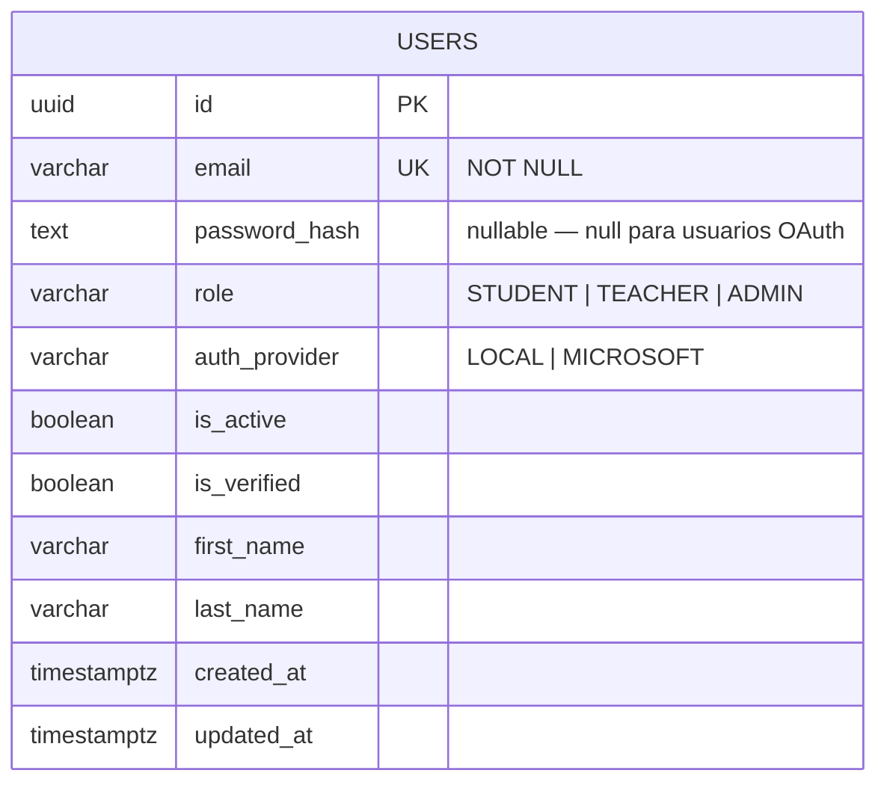
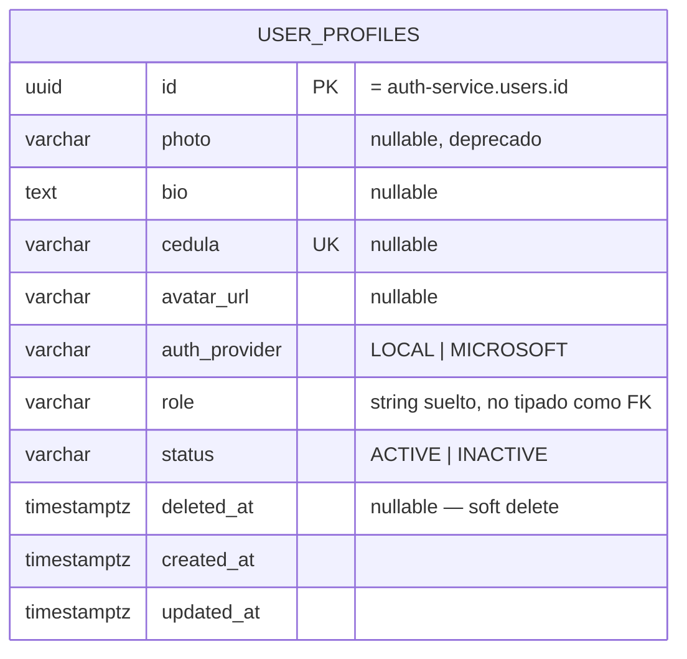
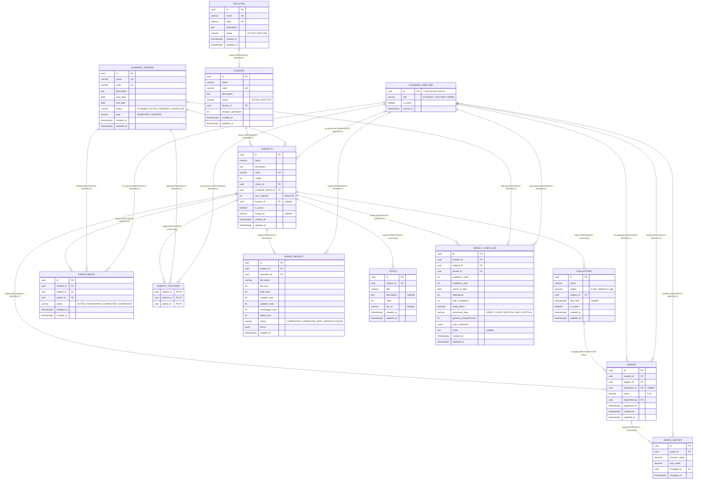
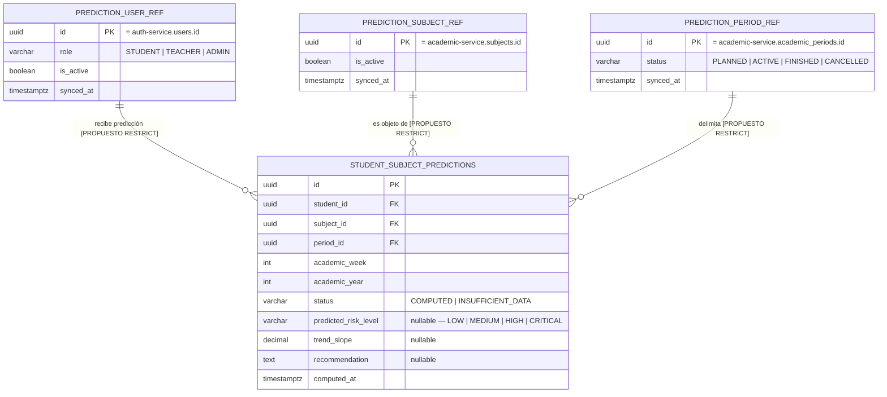

# Diagrama Entidad-Relación — Propuesta

> **Estado: las entidades/columnas de abajo son el estado actual, verificado (cruzado contra el `*.orm-entity.ts` de cada servicio, la misma fuente que [database-architecture.md](./database-architecture.md)). Relaciones, políticas `onDelete`, tablas de referencia y restricciones marcadas `[PROPUESTO]` no existen hoy en la base de datos** — son el diseño que este documento propone para las Fases 3-4 de la restructuración del modelo de datos. Hoy no existe ninguna foreign key física en todo el esquema; cada relación es una columna `uuid` suelta, reforzada solo por código de aplicación.
>
> Inspirado en el formato de `docs/backend/database-model.md` de `SIGLA-Backend` (un proyecto externo, sin relación con MentoraPredict, usado acá solo como referencia de formato de documentación) — un único `mermaid erDiagram` con anotaciones inline de `PK`/`FK`/`UK`, listas de valores de enum, y política `onDelete` explícita por relación. La versión de MentoraPredict difiere en un punto estructural que SIGLA no necesitaba resolver: SIGLA es un monolito de un solo servicio, así que cada relación podía ser una FK física. MentoraPredict son 5 microservicios compartiendo una única Postgres física — así que este documento tiene que trazar una línea que SIGLA nunca tuvo que trazar.
>
> **Estructura de este documento**: §2 tiene el diagrama completo (los 5 servicios juntos, para tener la vista de conjunto). §4 tiene el mismo contenido desglosado servicio por servicio, cada uno con su propio diagrama autocontenido y sus restricciones — pensado para trabajar en un solo servicio sin tener que cruzar todo el documento.

## 1. La regla que sigue este diagrama

**Una foreign key física solo se propone entre dos tablas que pertenecen al *mismo* servicio.** Las referencias cross-servicio (ej. `enrollments.student_id` apuntando a `users.id` de `auth-service`) se quedan como columnas `uuid` simples, sin restricción — reforzadas solo por código de aplicación, nunca por Postgres — aunque hoy los 5 servicios comparten una base de datos física y técnicamente sería posible poner una FK cross-servicio.

Esto es deliberado, no un descuido: la arquitectura hexagonal del proyecto trata a cada servicio como dueño de su propio contexto delimitado (bounded context). Una FK física desde las tablas de `academic-service` hacia la tabla `users` de `auth-service` dejaría que Postgres mismo acople dos servicios que se supone solo se comunican por HTTP — rompiendo el único límite arquitectónico que el esquema de TypeORM no puede ver.

## 2. Diagrama completo — los 5 servicios juntos

```mermaid
erDiagram
    %% ── auth-service ──────────────────────────────────────
    USERS {
        uuid id PK
        varchar email UK "NOT NULL"
        text password_hash "nullable — null para usuarios OAuth"
        varchar role "STUDENT | TEACHER | ADMIN"
        varchar auth_provider "LOCAL | MICROSOFT"
        boolean is_active
        boolean is_verified
        varchar first_name
        varchar last_name
        timestamptz created_at
        timestamptz updated_at
    }

    %% ── user-service ──────────────────────────────────────
    USER_PROFILES {
        uuid id PK "comparte valor con USERS.id por convención — cross-servicio, sin FK física"
        varchar photo "nullable, deprecado"
        text bio "nullable"
        varchar cedula UK "nullable"
        varchar avatar_url "nullable"
        varchar auth_provider "LOCAL | MICROSOFT"
        varchar role "string suelto, no tipado como FK"
        varchar status "ACTIVE | INACTIVE"
        timestamptz deleted_at "nullable — soft delete"
        timestamptz created_at
        timestamptz updated_at
    }

    %% ── academic-service (12 tablas + 1 de referencia) ──────
    FACULTIES {
        uuid id PK
        varchar name UK
        varchar code UK
        text description
        varchar status "ACTIVE | INACTIVE"
        timestamptz created_at
        timestamptz updated_at
    }

    CAREERS {
        uuid id PK
        varchar name
        varchar code UK
        text description
        varchar status "ACTIVE | INACTIVE"
        uuid faculty_id FK
        int duration_semesters
        timestamptz created_at
        timestamptz updated_at
    }

    ACADEMIC_PERIODS {
        uuid id PK
        varchar name UK
        varchar code UK
        text description
        date start_date
        date end_date
        varchar status "PLANNED | ACTIVE | FINISHED | CANCELLED"
        varchar type "SEMESTER | QUARTER"
        timestamptz created_at
        timestamptz updated_at
    }

    SUBJECTS {
        uuid id PK
        varchar name
        text description
        varchar code UK
        int credits
        uuid career_id FK
        uuid academic_period_id FK
        int max_capacity "default 30"
        uuid teacher_id FK "nullable"
        boolean is_active
        varchar image_url "nullable"
        timestamptz created_at
        timestamptz updated_at
    }

    EVALUATIONS {
        uuid id PK
        varchar name
        decimal weight "0-100, validado en app"
        uuid subject_id FK
        timestamptz due_date "nullable"
        boolean is_active
        timestamptz created_at
        timestamptz updated_at
    }

    ENROLLMENTS {
        uuid id PK
        uuid student_id FK
        uuid subject_id FK
        uuid period_id FK
        varchar status "ACTIVE | WITHDRAWN | COMPLETED | SUSPENDED"
        timestamptz enrolled_at
        timestamptz created_at
    }

    GRADES {
        uuid id PK
        uuid student_id FK
        uuid subject_id FK
        uuid evaluation_id FK "nullable"
        decimal value "0-20"
        uuid registered_by FK
        timestamptz registered_at
        timestamptz created_at
        timestamptz updated_at
    }

    GRADE_HISTORY {
        uuid id PK
        uuid grade_id FK
        decimal previous_value
        decimal new_value
        uuid changed_by FK
        timestamptz changed_at
    }

    SUBJECT_TEACHERS {
        uuid subject_id PK, FK
        uuid teacher_id PK, FK
        uuid period_id PK, FK
    }

    GRADE_IMPORTS {
        uuid id PK
        uuid subject_id FK
        uuid imported_by FK
        varchar file_name
        int file_size
        int total_rows
        int created_rows
        int updated_rows
        int unchanged_rows
        int failed_rows
        varchar status "COMPLETED | COMPLETED_WITH_ERRORS | FAILED"
        jsonb errors
        timestamptz created_at
    }

    TOPICS {
        uuid id PK
        uuid subject_id FK
        varchar title
        text description "nullable"
        int order
        varchar file_url "nullable"
        timestamptz created_at
        timestamptz updated_at
    }

    WEEKLY_CHECK_INS {
        uuid id PK
        uuid student_id FK
        uuid subject_id FK
        uuid period_id FK
        int academic_week
        int academic_year
        date check_in_date
        int attendance
        int task_completion
        decimal study_hours
        varchar emotional_state "GREAT | GOOD | NEUTRAL | BAD | CRITICAL"
        int general_comprehension
        jsonb topic_responses
        text notes "nullable"
        timestamptz created_at
        timestamptz updated_at
    }

    ACADEMIC_USER_REF {
        uuid id PK "= auth-service.users.id"
        varchar role "STUDENT | TEACHER | ADMIN"
        boolean is_active
        timestamptz synced_at
    }

    %% ── analytics-service (5 tablas + 3 de referencia) ──────
    STUDENT_METRICS {
        uuid id PK
        uuid student_id FK
        uuid period_id FK
        jsonb subject_averages
        decimal global_average
        timestamptz calculated_at
        int version "legacy, a nivel de estudiante — reemplazada por STUDENT_SUBJECT_METRICS"
    }

    STUDENT_SUBJECT_METRICS {
        uuid id PK
        uuid student_id FK
        uuid subject_id FK
        uuid period_id FK
        int academic_week
        int academic_year
        decimal average_grade "nullable = sin evaluaciones aún"
        int compliance_index "nullable"
        int attendance_rate "nullable"
        decimal study_hours "nullable"
        int comprehension_avg "nullable"
        varchar risk_level "nullable — LOW | MEDIUM | HIGH | CRITICAL"
        decimal trend_slope "nullable"
        timestamptz computed_at
    }

    ALERTS {
        uuid id PK
        uuid student_id FK
        varchar type "RISK_HIGH | RISK_CRITICAL | AVERAGE_DROP | FAILED_EVALUATIONS | LOW_ATTENDANCE | RISK_ESCALATION"
        text message
        varchar status "UNREAD | READ | ACTIVE | RESOLVED"
        jsonb metadata
        uuid subject_id FK "nullable"
        uuid period_id FK "nullable"
        varchar severity "nullable — MEDIUM | HIGH | CRITICAL"
        timestamptz triggered_at "nullable"
        timestamptz resolved_at "nullable"
        uuid resolved_by FK "nullable"
        timestamptz created_at
    }

    DEVICE_TOKENS {
        uuid id PK
        uuid user_id FK
        varchar expo_push_token UK
        varchar platform "ios | android | web"
        timestamptz created_at
    }

    NOTIFICATIONS {
        uuid id PK
        uuid recipient_id FK
        varchar recipient_role "STUDENT | TEACHER | ADMIN"
        varchar type
        uuid related_alert_id FK "nullable"
        uuid subject_id FK "nullable"
        uuid student_id FK "nullable"
        uuid period_id FK "nullable"
        varchar title
        text message
        varchar status "UNREAD | READ"
        timestamptz created_at
        timestamptz read_at "nullable"
    }

    ANALYTICS_USER_REF {
        uuid id PK "= auth-service.users.id"
        varchar role "STUDENT | TEACHER | ADMIN"
        boolean is_active
        timestamptz synced_at
    }

    ANALYTICS_SUBJECT_REF {
        uuid id PK "= academic-service.subjects.id"
        boolean is_active
        timestamptz synced_at
    }

    ANALYTICS_PERIOD_REF {
        uuid id PK "= academic-service.academic_periods.id"
        varchar status "PLANNED | ACTIVE | FINISHED | CANCELLED"
        timestamptz synced_at
    }

    %% ── prediction-service (1 tabla + 3 de referencia) ──────
    STUDENT_SUBJECT_PREDICTIONS {
        uuid id PK
        uuid student_id FK
        uuid subject_id FK
        uuid period_id FK
        int academic_week
        int academic_year
        varchar status "COMPUTED | INSUFFICIENT_DATA"
        varchar predicted_risk_level "nullable — LOW | MEDIUM | HIGH | CRITICAL"
        decimal trend_slope "nullable"
        text recommendation "nullable"
        timestamptz computed_at
    }

    PREDICTION_USER_REF {
        uuid id PK "= auth-service.users.id"
        varchar role "STUDENT | TEACHER | ADMIN"
        boolean is_active
        timestamptz synced_at
    }

    PREDICTION_SUBJECT_REF {
        uuid id PK "= academic-service.subjects.id"
        boolean is_active
        timestamptz synced_at
    }

    PREDICTION_PERIOD_REF {
        uuid id PK "= academic-service.academic_periods.id"
        varchar status "PLANNED | ACTIVE | FINISHED | CANCELLED"
        timestamptz synced_at
    }

    %% ── Relaciones físicas academic-service ─────────────────
    FACULTIES ||--o{ CAREERS : "posee [PROPUESTO RESTRICT]"
    CAREERS ||--o{ SUBJECTS : "ofrece [PROPUESTO RESTRICT]"
    ACADEMIC_PERIODS ||--o{ SUBJECTS : "delimita [PROPUESTO RESTRICT]"
    SUBJECTS ||--o{ EVALUATIONS : "define [PROPUESTO CASCADE]"
    SUBJECTS ||--o{ ENROLLMENTS : "recibe [PROPUESTO RESTRICT]"
    ACADEMIC_PERIODS ||--o{ ENROLLMENTS : "delimita [PROPUESTO RESTRICT]"
    SUBJECTS ||--o{ GRADES : "registra [PROPUESTO RESTRICT]"
    EVALUATIONS |o--o{ GRADES : "respalda [PROPUESTO SET NULL]"
    GRADES ||--o{ GRADE_HISTORY : "audita [PROPUESTO CASCADE]"
    SUBJECTS ||--o{ SUBJECT_TEACHERS : "asigna [PROPUESTO CASCADE]"
    ACADEMIC_PERIODS ||--o{ SUBJECT_TEACHERS : "delimita [PROPUESTO RESTRICT]"
    SUBJECTS ||--o{ GRADE_IMPORTS : "recibe [PROPUESTO RESTRICT]"
    SUBJECTS ||--o{ TOPICS : "contiene [PROPUESTO CASCADE]"
    SUBJECTS ||--o{ WEEKLY_CHECK_INS : "recibe [PROPUESTO RESTRICT]"
    ACADEMIC_PERIODS ||--o{ WEEKLY_CHECK_INS : "delimita [PROPUESTO RESTRICT]"
    ACADEMIC_USER_REF ||--o{ SUBJECTS : "es docente de [PROPUESTO RESTRICT]"
    ACADEMIC_USER_REF ||--o{ ENROLLMENTS : "se matricula [PROPUESTO RESTRICT]"
    ACADEMIC_USER_REF ||--o{ GRADES : "es calificado [PROPUESTO RESTRICT]"
    ACADEMIC_USER_REF ||--o{ GRADES : "registra [PROPUESTO RESTRICT]"
    ACADEMIC_USER_REF ||--o{ GRADE_HISTORY : "modifica [PROPUESTO RESTRICT]"
    ACADEMIC_USER_REF ||--o{ SUBJECT_TEACHERS : "es docente en [PROPUESTO RESTRICT]"
    ACADEMIC_USER_REF ||--o{ GRADE_IMPORTS : "importa [PROPUESTO RESTRICT]"
    ACADEMIC_USER_REF ||--o{ WEEKLY_CHECK_INS : "autorreporta [PROPUESTO RESTRICT]"

    %% ── Relaciones físicas analytics-service ────────────────
    ALERTS |o--o{ NOTIFICATIONS : "dispara [PROPUESTO SET NULL]"
    ANALYTICS_USER_REF ||--o{ STUDENT_METRICS : "es medido [PROPUESTO RESTRICT]"
    ANALYTICS_USER_REF ||--o{ STUDENT_SUBJECT_METRICS : "es medido [PROPUESTO RESTRICT]"
    ANALYTICS_USER_REF ||--o{ ALERTS : "recibe alerta [PROPUESTO RESTRICT]"
    ANALYTICS_USER_REF ||--o{ ALERTS : "resuelve [PROPUESTO RESTRICT]"
    ANALYTICS_USER_REF ||--o{ DEVICE_TOKENS : "posee [PROPUESTO RESTRICT]"
    ANALYTICS_USER_REF ||--o{ NOTIFICATIONS : "recibe [PROPUESTO RESTRICT]"
    ANALYTICS_SUBJECT_REF ||--o{ STUDENT_SUBJECT_METRICS : "es medida [PROPUESTO RESTRICT]"
    ANALYTICS_SUBJECT_REF ||--o{ ALERTS : "es objeto de [PROPUESTO RESTRICT]"
    ANALYTICS_SUBJECT_REF ||--o{ NOTIFICATIONS : "es objeto de [PROPUESTO RESTRICT]"
    ANALYTICS_PERIOD_REF ||--o{ STUDENT_METRICS : "delimita [PROPUESTO RESTRICT]"
    ANALYTICS_PERIOD_REF ||--o{ STUDENT_SUBJECT_METRICS : "delimita [PROPUESTO RESTRICT]"
    ANALYTICS_PERIOD_REF ||--o{ ALERTS : "delimita [PROPUESTO RESTRICT]"
    ANALYTICS_PERIOD_REF ||--o{ NOTIFICATIONS : "delimita [PROPUESTO RESTRICT]"

    %% ── Relaciones físicas prediction-service ───────────────
    PREDICTION_USER_REF ||--o{ STUDENT_SUBJECT_PREDICTIONS : "recibe predicción [PROPUESTO RESTRICT]"
    PREDICTION_SUBJECT_REF ||--o{ STUDENT_SUBJECT_PREDICTIONS : "es objeto de [PROPUESTO RESTRICT]"
    PREDICTION_PERIOD_REF ||--o{ STUDENT_SUBJECT_PREDICTIONS : "delimita [PROPUESTO RESTRICT]"
```

## 3. Patrón de tablas de referencia local (concepto general)

Todas las referencias cross-servicio (§5) hoy dependen 100% de la disciplina de la aplicación — nada en la base de datos las verifica. Se propone que cada servicio consumidor mantenga una **tabla de referencia local**: una copia mínima, de solo los campos que ese servicio realmente usa en su lógica de negocio, de la entidad externa que más referencia. Esto no reemplaza la fuente de verdad (sigue siendo el servicio dueño), pero habilita dos cosas que hoy no existen:

1. Una FK física real desde las tablas propias del servicio hacia esta tabla de referencia — Postgres puede rechazar un `student_id` que no exista localmente, en vez de confiar ciegamente en la aplicación.
2. Evitar una llamada HTTP repetida al servicio dueño para cada operación que solo necesita saber "¿existe esto, y en qué estado básico está?".

**Cómo se llena, dado que no existe ningún message broker en el sistema** (confirmado en [../architecture/high-level-architecture.md](../architecture/high-level-architecture.md)): vía *upsert* en el mismo punto donde cada servicio ya hace la llamada HTTP real — no se agrega ningún endpoint nuevo del lado del servicio dueño. Los detalles concretos (qué adaptador, qué campos) están en la sub-sección de cada servicio en §4.

**Límite importante, para no sobre-vender el beneficio**: esto es un caché de mejor esfuerzo, no una réplica sincronizada. Un usuario desactivado en `auth-service` puede seguir figurando como activo en la tabla de referencia local hasta la próxima vez que ese servicio lo consulte. Para decisiones de autorización (¿puede este usuario hacer esta acción?) sigue haciendo falta la llamada en vivo — la tabla de referencia es para integridad estructural y para evitar llamadas redundantes, no para seguridad.

## 4. Por microservicio

### 4.1 auth-service

No tiene ninguna FK, física ni cross-servicio — no referencia nada de otro servicio. Es la fuente de identidad a la que todos los demás apuntan (§5). No necesita tabla de referencia (no consume datos de nadie más). `role` y `auth_provider` ya están centralizados en `@mentorapredict/shared-types` (`Role`, `AuthProvider`) desde la Fase 1 — candidatos directos a `CHECK`/enum nativo de Postgres, sin necesidad de rediseño adicional.

| Restricción | Detalle |
|---|---|
| `CHECK` propuesto | `role IN ('STUDENT','TEACHER','ADMIN')`, `auth_provider IN ('LOCAL','MICROSOFT')` |
| Único ya existente | `email` (`UNIQUE`) |

### 4.2 user-service

Caso especial: `id` **es** el mismo valor que `auth-service.users.id` por convención, no una FK — es una extensión 1:1 de la misma entidad (el perfil vive en otra tabla/servicio, pero conceptualmente es "más columnas del mismo usuario"). No encaja en el patrón de tabla de referencia de §3 (ese patrón es para relaciones "muchos referencian a uno", acá es "uno extiende a uno"), y no se propone ninguna acá. `auth_provider` ya viene de `@mentorapredict/shared-types` desde la Fase 1; `role` se dejó deliberadamente como `string` suelto (ver Fase 1 — no había divergencia de valores que justificara tipar).

| Restricción | Detalle |
|---|---|
| `CHECK` propuesto | `auth_provider IN ('LOCAL','MICROSOFT')`, `status IN ('ACTIVE','INACTIVE')` |
| Único ya existente | `cedula` (`UNIQUE`, nullable) |

### 4.3 academic-service

El servicio más grande (12 tablas propias) y el que más referencia usuarios (7 columnas distintas).

**FK físicas propuestas (16, todas intra-servicio):**

| Desde | Hacia | `onDelete` | Por qué |
|---|---|---|---|
| `careers.faculty_id` | `faculties.id` | `RESTRICT` | Una facultad con carreras activas no debería desaparecer silenciosamente. |
| `subjects.career_id` | `careers.id` | `RESTRICT` | Misma razón. |
| `subjects.academic_period_id` | `academic_periods.id` | `RESTRICT` | Un período con materias programadas no es eliminable. |
| `subjects.teacher_id` | `academic_user_ref.id` | `RESTRICT` | Preserva la asignación docente en el registro histórico. |
| `evaluations.subject_id` | `subjects.id` | `CASCADE` | Una evaluación no tiene sentido sin su materia. |
| `enrollments.subject_id` | `subjects.id` | `RESTRICT` | Preservar el historial de matrículas aunque una materia se desactive en otro lugar. |
| `enrollments.period_id` | `academic_periods.id` | `RESTRICT` | Igual. |
| `enrollments.student_id` | `academic_user_ref.id` | `RESTRICT` | Preservar el historial de matrícula del estudiante. |
| `grades.subject_id` | `subjects.id` | `RESTRICT` | Las calificaciones son registros académicos permanentes. |
| `grades.evaluation_id` | `evaluations.id` | `SET NULL` | Ya es nullable hoy — borrar la evaluación desvincula la calificación en vez de borrar un registro permanente. |
| `grades.student_id`, `grades.registered_by` | `academic_user_ref.id` | `RESTRICT` | Registro académico permanente. |
| `grade_history.grade_id` | `grades.id` | `CASCADE` | Una fila de historial no tiene sentido sin su calificación padre. |
| `grade_history.changed_by` | `academic_user_ref.id` | `RESTRICT` | Rastro de auditoría. |
| `subject_teachers.subject_id` | `subjects.id` | `CASCADE` | Registro puro de asignación — sin significado independiente. |
| `subject_teachers.period_id` | `academic_periods.id` | `RESTRICT` | Preservar la integridad del período. |
| `subject_teachers.teacher_id` | `academic_user_ref.id` | `CASCADE` | Igual que `subject_id` — registro de asignación. |
| `grade_imports.subject_id` | `subjects.id` | `RESTRICT` | Rastro de auditoría de una operación masiva — se conserva. |
| `grade_imports.imported_by` | `academic_user_ref.id` | `RESTRICT` | Rastro de auditoría. |
| `topics.subject_id` | `subjects.id` | `CASCADE` | El contenido del sílabo no tiene sentido fuera de su materia. |
| `weekly_check_ins.subject_id` | `subjects.id` | `RESTRICT` | Preservar el historial de autorreporte. |
| `weekly_check_ins.period_id` | `academic_periods.id` | `RESTRICT` | Igual. |
| `weekly_check_ins.student_id` | `academic_user_ref.id` | `RESTRICT` | Preservar el historial de autorreporte. |

**Tabla de referencia local — `user_references`:**

| Columna | Tipo | Por qué |
|---|---|---|
| `id` | `uuid` PK | mismo valor que `auth-service.users.id` |
| `role` | `varchar` | varios use cases filtran/validan por rol (ej. solo un `teacher_id` con rol `TEACHER` puede asignarse a una materia) |
| `is_active` | `boolean` | `check-user-deactivation-eligibility.use-case.ts` y las validaciones de matrícula ya dependen de esto |
| `synced_at` | `timestamptz` | qué tan vieja es la copia local |

Se llena vía *upsert* en `UserProfileAdapter.getProfile()` (`services/academic-service/src/infrastructure/adapters/user-profile.adapter.ts`), que ya hace esta llamada HTTP a `user-service` hoy. Campos tomados de `UserProfileData`, recortados: `firstName`/`lastName`/`email` **no se replican** — son datos de presentación, se siguen pidiendo en vivo cuando hace falta mostrarlos.

**Otras restricciones propuestas:**

| Restricción | Detalle |
|---|---|
| Único faltante | `enrollments(student_id, subject_id, period_id)` — hoy nada impide una matrícula duplicada. |
| Índice único ya existente | `academic_periods` — parcial, `status = 'ACTIVE'` (un solo período activo) |
| Índice único ya existente | `weekly_check_ins(student_id, subject_id, academic_week, academic_year)` |
| `CHECK` propuesto | `enrollments.status IN (...)` (4 valores, ya centralizado en shared-types desde Fase 1), `faculties.status`/`careers.status IN ('ACTIVE','INACTIVE')`, `academic_periods.status IN ('PLANNED','ACTIVE','FINISHED','CANCELLED')`, `academic_periods.type IN ('SEMESTER','QUARTER')`, `grade_imports.status IN ('COMPLETED','COMPLETED_WITH_ERRORS','FAILED')`, `weekly_check_ins.emotional_state IN ('GREAT','GOOD','NEUTRAL','BAD','CRITICAL')` |

### 4.4 analytics-service

```mermaid
erDiagram
    STUDENT_METRICS {
        uuid id PK
        uuid student_id FK
        uuid period_id FK
        jsonb subject_averages
        decimal global_average
        timestamptz calculated_at
        int version "legacy — reemplazada por STUDENT_SUBJECT_METRICS"
    }

    STUDENT_SUBJECT_METRICS {
        uuid id PK
        uuid student_id FK
        uuid subject_id FK
        uuid period_id FK
        int academic_week
        int academic_year
        decimal average_grade "nullable = sin evaluaciones aún"
        int compliance_index "nullable"
        int attendance_rate "nullable"
        decimal study_hours "nullable"
        int comprehension_avg "nullable"
        varchar risk_level "nullable — LOW | MEDIUM | HIGH | CRITICAL"
        decimal trend_slope "nullable"
        timestamptz computed_at
    }

    ALERTS {
        uuid id PK
        uuid student_id FK
        varchar type "RISK_HIGH | RISK_CRITICAL | AVERAGE_DROP | FAILED_EVALUATIONS | LOW_ATTENDANCE | RISK_ESCALATION"
        text message
        varchar status "UNREAD | READ | ACTIVE | RESOLVED"
        jsonb metadata
        uuid subject_id FK "nullable"
        uuid period_id FK "nullable"
        varchar severity "nullable — MEDIUM | HIGH | CRITICAL"
        timestamptz triggered_at "nullable"
        timestamptz resolved_at "nullable"
        uuid resolved_by FK "nullable"
        timestamptz created_at
    }

    DEVICE_TOKENS {
        uuid id PK
        uuid user_id FK
        varchar expo_push_token UK
        varchar platform "ios | android | web"
        timestamptz created_at
    }

    NOTIFICATIONS {
        uuid id PK
        uuid recipient_id FK
        varchar recipient_role "STUDENT | TEACHER | ADMIN"
        varchar type
        uuid related_alert_id FK "nullable"
        uuid subject_id FK "nullable"
        uuid student_id FK "nullable"
        uuid period_id FK "nullable"
        varchar title
        text message
        varchar status "UNREAD | READ"
        timestamptz created_at
        timestamptz read_at "nullable"
    }

    ANALYTICS_USER_REF {
        uuid id PK "= auth-service.users.id"
        varchar role "STUDENT | TEACHER | ADMIN"
        boolean is_active
        timestamptz synced_at
    }

    ANALYTICS_SUBJECT_REF {
        uuid id PK "= academic-service.subjects.id"
        boolean is_active
        timestamptz synced_at
    }

    ANALYTICS_PERIOD_REF {
        uuid id PK "= academic-service.academic_periods.id"
        varchar status "PLANNED | ACTIVE | FINISHED | CANCELLED"
        timestamptz synced_at
    }

    ALERTS |o--o{ NOTIFICATIONS : "dispara [PROPUESTO SET NULL]"
    ANALYTICS_USER_REF ||--o{ STUDENT_METRICS : "es medido [PROPUESTO RESTRICT]"
    ANALYTICS_USER_REF ||--o{ STUDENT_SUBJECT_METRICS : "es medido [PROPUESTO RESTRICT]"
    ANALYTICS_USER_REF ||--o{ ALERTS : "recibe alerta [PROPUESTO RESTRICT]"
    ANALYTICS_USER_REF ||--o{ ALERTS : "resuelve [PROPUESTO RESTRICT]"
    ANALYTICS_USER_REF ||--o{ DEVICE_TOKENS : "posee [PROPUESTO RESTRICT]"
    ANALYTICS_USER_REF ||--o{ NOTIFICATIONS : "recibe [PROPUESTO RESTRICT]"
    ANALYTICS_SUBJECT_REF ||--o{ STUDENT_SUBJECT_METRICS : "es medida [PROPUESTO RESTRICT]"
    ANALYTICS_SUBJECT_REF ||--o{ ALERTS : "es objeto de [PROPUESTO RESTRICT]"
    ANALYTICS_SUBJECT_REF ||--o{ NOTIFICATIONS : "es objeto de [PROPUESTO RESTRICT]"
    ANALYTICS_PERIOD_REF ||--o{ STUDENT_METRICS : "delimita [PROPUESTO RESTRICT]"
    ANALYTICS_PERIOD_REF ||--o{ STUDENT_SUBJECT_METRICS : "delimita [PROPUESTO RESTRICT]"
    ANALYTICS_PERIOD_REF ||--o{ ALERTS : "delimita [PROPUESTO RESTRICT]"
    ANALYTICS_PERIOD_REF ||--o{ NOTIFICATIONS : "delimita [PROPUESTO RESTRICT]"
```

**FK físicas propuestas:**

| Desde | Hacia | `onDelete` | Por qué |
|---|---|---|---|
| `notifications.related_alert_id` | `alerts.id` | `SET NULL` | Ya es nullable — una notificación debería sobrevivir a que su alerta disparadora se resuelva/elimine. |
| `student_metrics.student_id`, `student_subject_metrics.student_id`, `alerts.student_id`, `alerts.resolved_by`, `device_tokens.user_id`, `notifications.recipient_id`, `notifications.student_id` | `analytics_user_ref.id` | `RESTRICT` | Registros de métricas/alertas permanentes. |
| `student_subject_metrics.subject_id`, `alerts.subject_id`, `notifications.subject_id` | `analytics_subject_ref.id` | `RESTRICT` | Igual. |
| `student_metrics.period_id`, `student_subject_metrics.period_id`, `alerts.period_id`, `notifications.period_id` | `analytics_period_ref.id` | `RESTRICT` | Igual. |

**Tablas de referencia local:**

- **`user_references`**: mismos 4 campos que en `academic-service` (`id`, `role`, `is_active`, `synced_at`). El único consumo real hoy es `getUserIdsByRole()` (`services/analytics-service/src/notifications/domain/ports/i-user-service.client.ts`), que solo necesita `id` + `role` — `is_active` se agrega igual porque no deberían generarse alertas/notificaciones para usuarios desactivados.
- **`subject_references`**: `id` (PK), `is_active`, `synced_at`.
- **`period_references`**: `id` (PK), `status` (`PLANNED`/`ACTIVE`/`FINISHED`/`CANCELLED`), `synced_at` — `status` es el único campo realmente consultado en lógica (ej. no calcular tendencia sobre un período cancelado).

**Otras restricciones propuestas:**

| Restricción | Detalle |
|---|---|
| Índice único ya existente | `student_subject_metrics(student_id, subject_id, academic_week, academic_year)`; `alerts` — parcial, `(student_id, subject_id)` donde `status = 'ACTIVE'`; `device_tokens.expo_push_token` |
| `CHECK` propuesto | `student_subject_metrics.risk_level IN (...)` (4 valores, shared-types), `alerts.type`/`.status`/`.severity`, `device_tokens.platform IN ('ios','android','web')`, `notifications.recipient_role IN ('STUDENT','TEACHER','ADMIN')`/`.type`/`.status` |

### 4.5 prediction-service

**FK físicas propuestas:**

| Desde | Hacia | `onDelete` | Por qué |
|---|---|---|---|
| `student_subject_predictions.student_id` | `prediction_user_ref.id` | `RESTRICT` | Registro de predicción permanente. |
| `student_subject_predictions.subject_id` | `prediction_subject_ref.id` | `RESTRICT` | Igual. |
| `student_subject_predictions.period_id` | `prediction_period_ref.id` | `RESTRICT` | Igual. |

**Tablas de referencia local**: mismo patrón y mismos campos mínimos que en `analytics-service` (§4.4). La fuente real hoy es `IAcademicContextClient` (`services/prediction-service/src/application/ports/output/i-academic-context.client.ts`), que ya trae `subjectId`/`name`/`credits` — `name`/`credits` se quedan como datos de presentación pedidos en vivo, no se replican.

**Otras restricciones propuestas:**

| Restricción | Detalle |
|---|---|
| Índice único ya existente | `student_subject_predictions(student_id, subject_id, academic_week, academic_year)` |
| `CHECK` propuesto | `status IN ('COMPUTED','INSUFFICIENT_DATA')`, `predicted_risk_level IN (...)` (4 valores, shared-types) |

## 5. Referencias cross-servicio — tabla consolidada

Vista rápida de todas las referencias de §4 en un solo lugar. Cada una es una columna `uuid` que apunta a la tabla real, dueña del dato, en otro servicio — esa relación con la fuente de verdad nunca tendrá FK física, según la regla de §1 (las tablas de referencia local de §3-4 son un espejo, no la relación en sí).

| Columna | Apunta a | Servicio dueño del destino |
|---|---|---|
| `user_profiles.id` | `users.id` (1:1, valor compartido por convención) | auth-service |
| `subjects.teacher_id`, `enrollments.student_id`, `grades.student_id`/`registered_by`, `grade_history.changed_by`, `subject_teachers.teacher_id`, `grade_imports.imported_by`, `weekly_check_ins.student_id` | `users.id` | auth-service |
| `student_metrics.student_id`, `student_subject_metrics.student_id`, `alerts.student_id`, `alerts.resolved_by`, `device_tokens.user_id`, `notifications.recipient_id`, `notifications.student_id`, `student_subject_predictions.student_id` | `users.id` | auth-service |
| `student_metrics.period_id`, `student_subject_metrics.period_id`, `alerts.period_id`, `notifications.period_id`, `student_subject_predictions.period_id` | `academic_periods.id` | academic-service |
| `student_subject_metrics.subject_id`, `alerts.subject_id`, `notifications.subject_id`, `student_subject_predictions.subject_id` | `subjects.id` | academic-service |

## 6. Vacíos de restricciones transversales

Ya desglosados por servicio en §4 — acá el resumen de los dos que no son específicos de un solo servicio:

- **`enrollments` no tiene ningún unique constraint.** `(student_id, subject_id, period_id)` debería ser único. `[PROPUESTO]`
- **No existe ningún `CHECK`/enum nativo de Postgres para ninguna columna de estado**, en ningún servicio. Cada una se valida solo en código de aplicación. Los datos semilla de `EnrollmentStatus` ya demostraron que esto no es teórico — ver [database-architecture.md](./database-architecture.md) y [../business/business-logic.md](../business/business-logic.md) §5.

## 7. Entidades por rol (STUDENT / TEACHER / ADMIN)

Una lente sobre el mismo diagrama, no un modelo de datos distinto — qué rol típicamente lee/escribe cada tabla, según los endpoints reales documentados en [../api/api-contracts.md](../api/api-contracts.md) y las reglas de rol en [../business/business-logic.md](../business/business-logic.md) §2.

| Entidad | STUDENT | TEACHER | ADMIN |
|---|:---:|:---:|:---:|
| `USERS`, `USER_PROFILES` | solo su propio registro | solo su propio registro | CRUD completo |
| `FACULTIES`, `CAREERS`, `ACADEMIC_PERIODS` | solo lectura | solo lectura | CRUD completo |
| `SUBJECTS` | lectura (solo matriculadas) | lectura/escritura (solo propias) | CRUD completo |
| `EVALUATIONS`, `GRADES`, `GRADE_HISTORY`, `GRADE_IMPORTS` | lectura (sus propias notas) | escritura (materias propias) | lectura completa |
| `ENROLLMENTS` | lectura (propias) | escritura (materias propias) | CRUD completo |
| `SUBJECT_TEACHERS` | — | lectura (propias) | CRUD completo |
| `TOPICS` | lectura | escritura (materias propias) | lectura completa |
| `WEEKLY_CHECK_INS` | escritura (propio, autorreporte) | lectura (materias propias) | lectura completa |
| `STUDENT_METRICS`, `STUDENT_SUBJECT_METRICS`, `ALERTS` | lectura (propias) | lectura (estudiantes de materias propias) | lectura (institución completa) |
| `DEVICE_TOKENS`, `NOTIFICATIONS` | solo propias | solo propias | solo propias |
| `STUDENT_SUBJECT_PREDICTIONS` | lectura (propias, disparo con límite de tasa) | — | — |

## 8. Fuentes

Inventario de entidades/columnas: auditoría dedicada de los 20 archivos `*.orm-entity.ts` de los 5 servicios (relaciones, `onDelete`, índices, columnas respaldadas por enum), cruzado contra la lista de tablas verificada por seeds de [database-architecture.md](./database-architecture.md). Propuesta de relaciones/restricciones: diseñada para este documento, tomando como referencia de formato `docs/backend/database-model.md` de `SIGLA-Backend` (proyecto externo de referencia, solo en formato — su dominio no tiene relación). Propuesta de tablas de referencia local (§3-4): campos verificados contra los adaptadores HTTP reales ya existentes (`i-user-profile.port.ts`/`user-profile.adapter.ts` en `academic-service`, `i-user-service.client.ts` en `analytics-service`, `i-academic-context.client.ts` en `prediction-service`). Tabla de propiedad por rol: cruzada contra [../api/api-contracts.md](../api/api-contracts.md) y [../business/business-logic.md](../business/business-logic.md) §2-3.
