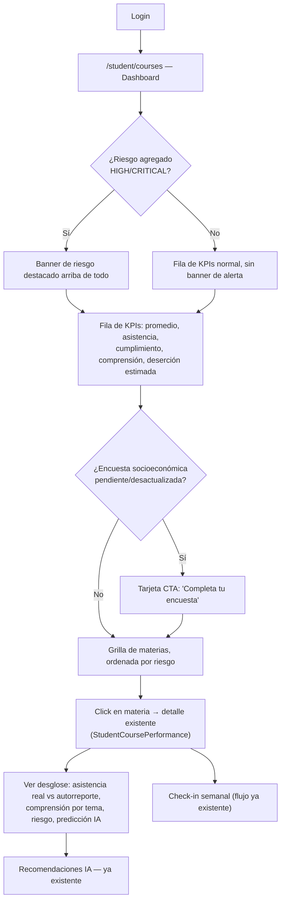
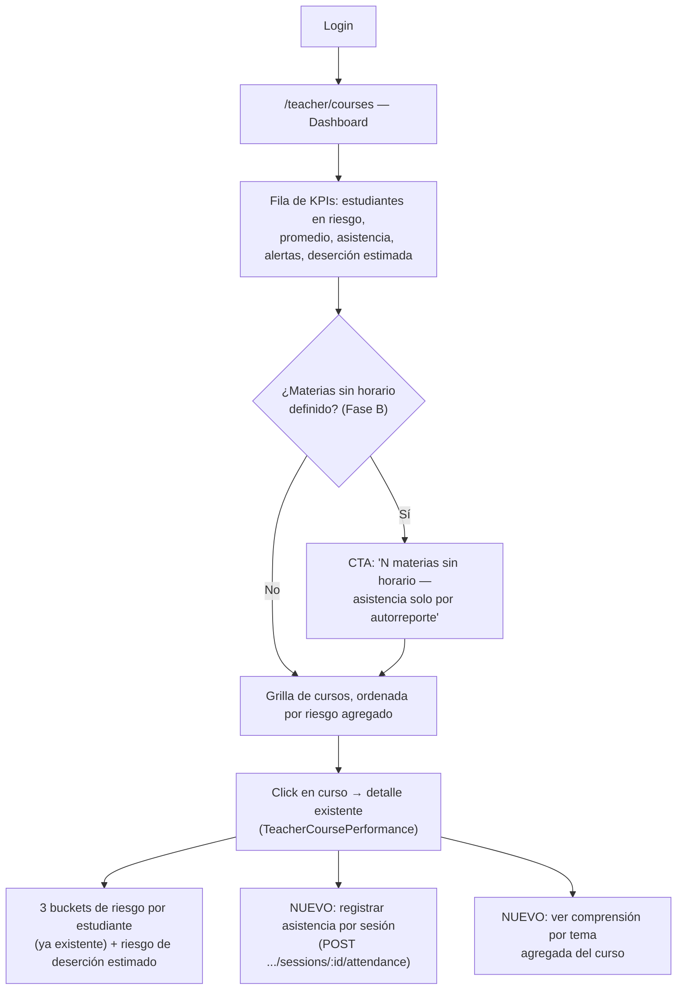

# Propuesta — KPIs y rediseño de los dashboards STUDENT/TEACHER

> **Documento histórico.** Describe MentoraPredict cuando era un sistema universitario (facultades, carreras, créditos, escala 0–20). Esa estructura se retiró en la conversión a sistema de gestión escolar; el estado vigente está en [docs/erp-escolar/10-estado-de-implementacion.md](../erp-escolar/10-estado-de-implementacion.md).

> **Estado: propuesta de diseño, nada implementado todavía.** Este documento define qué KPIs agregar, con qué datos (reales o mockeados) y qué flujo de usuario, para que `apps/web` cumpla el objetivo real del proyecto — confirmado por [`business-logic.md`](../business/business-logic.md) y [`dropout-prediction-proposal.md`](../business/dropout-prediction-proposal.md) — de **determinar riesgo académico por estudiante y, a futuro, riesgo de deserción institucional**. Sigue el mismo formato que [`database-update-plan.md`](../database/database-update-plan.md): diagnóstico → propuesta → datos necesarios → fases. Producido a partir de una auditoría dedicada del estado real de `apps/web` (ver §8, Fuentes).

## 1. Por qué este rediseño, y no solo "agregar tarjetitas"

El backend ya calcula, o va a poder calcular tras las Fases A-E (`docs/database/database-update-plan.md`), bastante más de lo que el frontend hoy muestra. El dashboard actual no es *incorrecto* — es **incompleto respecto a su propio objetivo**: un estudiante o docente puede pasar por él sin enterarse de que está en riesgo, porque el riesgo está enterrado por materia, nunca agregado ni destacado.

Diagnóstico concreto (ver §8 para el detalle de la auditoría):

| | STUDENT (`/student/courses`) | TEACHER (`/teacher/courses`) |
|---|---|---|
| KPIs agregados hoy | 4 (materias activas, promedio, alertas, créditos) — ninguno es "riesgo" | **0** — solo una grilla de tarjetas por curso |
| Riesgo visible | Sí, pero solo como badge por materia individual, nunca agregado | No hay ninguna vista agregada de riesgo entre cursos |
| Asistencia | No se muestra en ningún lado del dashboard | No se muestra en ningún lado del dashboard |
| Cumplimiento (`compliance_index`) | Existe en el backend, no se muestra | No se muestra |
| Comprensión por tema | No se muestra agregada (solo el detalle de un check-in individual) | No se muestra |
| Riesgo de deserción | No existe (ver `dropout-prediction-proposal.md`) | No existe |
| Actividad/engagement (Fase E) | No existe ningún consumo de `login_events` | No existe |
| Encuesta socioeconómica (Fase D) | No hay ningún widget de estado/recordatorio | No aplica |

El resultado: el estudiante que más necesita ver "estás en riesgo" tiene que entrar materia por materia para enterarse, y el docente no tiene ninguna vista de "¿a quién de mis N estudiantes tengo que mirar primero?" — tiene que abrir cada curso y cada lista para encontrarlo. Este documento propone cerrar exactamente eso.

## 2. Principio de diseño para el mock: la mentira vive en el hook, no en el componente

Petición explícita del usuario: no hace falta esperar al backend, se mockea y se integra después. Para que ese "después" sea barato (cambiar una función, no reescribir componentes), el mock **nunca vive dentro de un componente** — vive en la misma capa de servicio/hook que ya usa el resto del repo (`services/*.service.ts` + `hooks/queries/*.ts`, patrón React Query confirmado en la auditoría, §8).

```
Componente  →  hook (useDropoutRisk, useAttendanceKpi, ...)  →  función de datos
                                                                   ├── HOY: mock (misma forma que la respuesta real futura)
                                                                   └── MAÑANA: llamada Axios real (mismo shape, mismo hook, cero cambios en el componente)
```

Cada hook nuevo devuelve, además de `data`/`isLoading`/`error`, un flag `isMocked: boolean` — así el componente puede mostrar un badge "Estimación preliminar" **sin saber que está mockeado**, solo reaccionando al flag. El día que el hook cambie su `queryFn` de mock a Axios real, ese flag pasa a `false` solo y el badge desaparece sin tocar el componente. Ningún componente debe importar una función de mock directamente.

No se propone introducir MSW ni ninguna infraestructura de mocking a nivel de red — el repo no tiene nada de eso hoy (confirmado, §8) y sería sobre-ingeniería para este alcance. Basta con funciones TypeScript tipadas que devuelven una `Promise` con latencia artificial (`~300-600ms`, para que los estados de loading ya queden bien resueltos cuando llegue el dato real).

## 3. KPIs propuestos — STUDENT

Fila de KPIs ampliada + un banner de riesgo agregado nuevo, arriba de todo (hoy no existe nada que ocupe ese lugar).

| KPI | Qué muestra | Fuente | Esfuerzo de integración real futura |
|---|---|---|---|
| **Banner de riesgo agregado** (nuevo, el más importante) | "Estás en zona {LOW\|MEDIUM\|HIGH\|CRITICAL}" — el peor `riskLevel` entre las materias activas, con una frase corta de por qué | **Ninguno — calculable HOY mismo**, agregando client-side el `riskLevel` que `StudentSubjectOverview` ya trae por materia | Bajo (es agregación pura, no necesita mock) |
| Promedio general | Ya existe hoy, se mantiene | Real, ya consumido | — |
| **Asistencia real** (nuevo, Fase B) | % de sesiones con presencia, distinguiendo si viene de registro docente o autorreporte | Mock — `session_attendances` existe en BD pero **ningún endpoint la expone agregada** todavía | Alto — falta un endpoint nuevo |
| **Cumplimiento** (nuevo) | `compliance_index` (cumplimiento de tareas) agregado | Mock, aunque el dato **ya existe en `student_subject_metrics`** — el endpoint que consume el frontend (`getStudentSubjectsOverview`) simplemente no lo incluye en su respuesta hoy | Medio — extender un DTO existente, no una tabla nueva |
| **Comprensión por tema** (nuevo, Fase C) | Tendencia de comprensión + los 2-3 temas más débiles, para saber qué repasar | Mock — la tabla `weekly_check_in_topic_responses` existe (Fase C) pero no hay ningún endpoint agregador | Alto — falta un endpoint nuevo |
| **Riesgo de deserción (estimado)** (nuevo, el KPI "estrella" pedido) | Score 0-100 + nivel, con los factores que lo componen | Mock puro, marcado explícitamente como estimación (§5) | Muy alto — requiere construir `CalculateDropoutRiskUseCase` completo (`dropout-prediction-proposal.md` §7-8), que hoy no existe en ningún servicio |
| **Actividad reciente** (nuevo, Fase E) | "Última vez que entraste: hace N días" + racha de días activos | Mock — `login_events` existe (Fase E) pero **no tiene ningún endpoint de lectura** (gap ya documentado en `business-logic.md` §6) | Alto — falta un endpoint nuevo |
| **Encuesta socioeconómica** (nuevo, Fase D) | Tarjeta de estado: respondida / pendiente / desactualizada, con CTA a responder | Puede usar el endpoint real `GET /students/me/survey-responses`, **ya existe** | Bajo — el endpoint ya existe, solo falta consumirlo |
| Alertas académicas | Ya existe hoy, se mantiene | Real, ya consumido | — |
| Créditos activos | Ya existe hoy, se mantiene tal cual — es el menos relevante para el objetivo de riesgo, candidato a bajar de prioridad visual | Real, ya consumido | — |

Cambio adicional propuesto: la grilla de materias (`CourseGrid`) pasa a **ordenarse por riesgo descendente** (CRITICAL/HIGH primero) en vez del orden actual — el estudiante ve primero la materia que más necesita atención.

## 4. KPIs propuestos — TEACHER

Hoy no existe absolutamente ninguna fila de KPIs agregados — se propone construirla desde cero, con la misma lógica que STUDENT pero a nivel "todos mis cursos".

| KPI | Qué muestra | Fuente | Esfuerzo de integración real futura |
|---|---|---|---|
| **Estudiantes en riesgo (HIGH+CRITICAL)** (nuevo, el más importante) | Conteo total entre todos sus cursos, clicable → filtra la lista | **Ninguno — calculable HOY**, agregando lo que `getSubjectMetricsSummary` ya trae por curso | Bajo |
| Promedio general de mis cursos | Media ponderada de `currentAverage` entre cursos | Real, agregable HOY desde datos ya consumidos | Bajo |
| **Asistencia promedio de mis cursos** (nuevo, Fase B) | Igual que en STUDENT pero agregado por docente | Mock | Alto |
| **Alertas activas sin resolver** (nuevo) | Hoy solo existe dentro del detalle de cada curso (`CourseAlertsPanel`) — nunca agregado | Real, agregable si se pide una alerta por curso (o mock si se prefiere no disparar N llamados) | Bajo-Medio |
| **Materias sin horario definido** (nuevo, CTA operativo, Fase B) | "N de tus materias no tienen horario — la asistencia sigue siendo 100% autorreporte del estudiante", con link directo a definirlo | Mock hasta que exista un endpoint que devuelva `class_schedules.length` por materia (hoy sí existe el endpoint de definición, `POST /subjects/:id/schedule`, falta el de consulta agregada) | Medio |
| **Estudiantes en riesgo de deserción (estimado)** (nuevo) | Conteo agregado, mismo motor mockeado que STUDENT §5 | Mock puro | Muy alto |
| Tendencia de mis cursos | ASCENDING/STABLE/DESCENDING agregado, mismo concepto que `CalculateTrendUseCase` (hoy solo existe a nivel estudiante individual) | Mock | Alto |

La grilla de cursos (`CourseGrid`) también pasa a **ordenarse por riesgo agregado del curso** (más estudiantes en riesgo primero), reemplazando el orden actual sin criterio de riesgo.

## 5. El KPI de riesgo de deserción — cómo mockearlo sin mentir

`dropout-prediction-proposal.md` ya deja definido el enfoque correcto (§7 de ese documento): un **score compuesto, determinístico y ponderado** (no un modelo de ML entrenado — no hay datos suficientes, ver §3 de ese mismo documento), con estos factores:

| Factor | Peso relativo | De dónde sale hoy (real o mock) |
|---|---|---|
| Tendencia de promedio entre períodos | Alto | Mock — requiere ≥3 períodos con datos reales, hoy solo existe 2026-A poblado (ver `dropout-prediction-proposal.md` §3) |
| Tendencia de cumplimiento/asistencia | Alto | Mock |
| Reducción de carga de materias entre períodos | Medio | Mock |
| Retiros (`WITHDRAWN`) acumulados en el período actual | Medio | Puede calcularse real hoy mismo (el dato existe) |
| Estado emocional autorreportado sostenido (`BAD`/`CRITICAL`) | Medio | Puede calcularse real hoy mismo (`weekly_check_ins.emotionalState` existe) |
| Frecuencia de alertas HIGH/CRITICAL | Medio | Real, ya disponible |
| Encuesta socioeconómica (Fase D, cierra un gap que el propio `dropout-prediction-proposal.md` §9 marcaba como faltante) | Por definir | Mock — todavía no hay reglas de cómo pesar las respuestas |

**Importante — no ocultar que es una estimación.** El mock de este KPI debe:
1. Llevar siempre `isMocked: true` y una razón (`dataSource: 'MOCK_HEURISTIC'`).
2. Mostrarse con un tratamiento visual distinto (badge "Estimación preliminar" o "Beta", tono de color distinto al resto de KPIs reales) — nunca con el mismo peso visual que un dato verificado, para no generar una falsa sensación de precisión ante estudiantes/docentes reales.
3. Incluir en el detalle (tooltip o panel expandible) los factores que lo componen — mismo patrón que `CourseRiskBars` ya usa hoy para riesgo por materia, reutilizable.

Cuando exista `CalculateDropoutRiskUseCase` en `analytics-service` (backend, fuera de alcance de esta propuesta), la única migración necesaria es: (a) cambiar la `queryFn` del hook de mock a Axios real, (b) el backend ya deja `isMocked` inexistente/`false` en su respuesta real.

## 6. Flujo de usuario propuesto

### 6.1 STUDENT



### 6.2 TEACHER



## 7. Datos mockeados necesarios

Todos los shapes nuevos reutilizan/extienden los tipos reales ya existentes en `apps/web/src/types/course/` y `apps/web/src/services/course-analytics.service.ts` (ver §8) — no se inventan tipos paralelos donde ya hay uno real.

**Corrección de deuda técnica recomendada como parte de este trabajo**: hoy conviven dos enums de riesgo distintos (`CourseRiskLevel = HIGH|MEDIUM|LOW|UNKNOWN` en `types/course/course.types.ts`, y un `RiskLevel = LOW|MEDIUM|HIGH|CRITICAL` local no exportado en `course-analytics.service.ts`, que sí coincide con `@mentorapredict/shared-types`). Se propone unificar a un solo `RiskLevel` (el de 4 valores, coincide con backend) y decidir qué hacer con `UNKNOWN` (mapear a "sin datos suficientes" en vez de un 5to nivel de riesgo).

```ts
// apps/web/src/types/risk/risk-level.types.ts (nuevo, único punto de verdad)
export type RiskLevel = 'LOW' | 'MEDIUM' | 'HIGH' | 'CRITICAL';
export type RiskDataAvailability = 'AVAILABLE' | 'INSUFFICIENT_DATA';

// apps/web/src/features/dashboard/types/dashboard-kpi.types.ts (nuevo)

export interface AggregatedRiskSummary {
  level: RiskLevel;
  availability: RiskDataAvailability;
  worstSubjectId: string | null;
  reason: string; // frase corta para el banner, ej. "Tu promedio en Base de Datos I bajó 2 puntos esta semana"
}

export interface SubjectAttendanceBreakdown {
  subjectId: string;
  sessionsHeld: number;
  sessionsRecordedByTeacher: number;
  attendanceRateTeacher: number | null;      // 0-100, null si el docente nunca registró nada
  attendanceRateSelfReport: number;          // 0-100, siempre disponible
  effectiveAttendanceRate: number;           // la que gana por precedencia (docente > autorreporte)
  source: 'TEACHER' | 'STUDENT_SELF_REPORT' | 'MIXED' | 'NO_SCHEDULE';
}

export interface DashboardAttendanceSummary {
  overallRate: number;
  subjects: SubjectAttendanceBreakdown[];
  unscheduledSubjectsCount: number;          // materias sin class_schedules todavía
}

export interface ComplianceSummary {
  overallComplianceIndex: number;            // 0-100
  bySubject: { subjectId: string; complianceIndex: number }[];
}

export interface TopicComprehensionPoint {
  topicId: string;
  topicTitle: string;
  order: number;
  comprehension: number; // 0-100, más reciente
}

export interface SubjectComprehensionSummary {
  subjectId: string;
  averageComprehension: number;
  weakestTopics: TopicComprehensionPoint[];  // 2-3 peores, "qué repasar"
  trend: 'IMPROVING' | 'STABLE' | 'WORSENING';
}

export interface DropoutRiskFactor {
  key: 'AVERAGE_TREND' | 'COMPLIANCE_TREND' | 'SUBJECT_LOAD_TREND'
     | 'WITHDRAWALS' | 'EMOTIONAL_STATE' | 'ALERT_FREQUENCY' | 'ENGAGEMENT' | 'SOCIOECONOMIC';
  label: string;
  weight: number;           // 0-1, suma total = 1
  normalizedScore: number;  // 0-100
}

export interface DropoutRiskEstimate {
  score: number;             // 0-100 compuesto
  level: RiskLevel;
  factors: DropoutRiskFactor[];
  isMocked: boolean;         // true hoy, false cuando exista CalculateDropoutRiskUseCase real
  dataSource: 'MOCK_HEURISTIC' | 'BACKEND_COMPUTED';
  computedAt: string;
  disclaimer: string | null; // texto a mostrar en UI mientras isMocked === true
}

export interface EngagementSummary {
  lastLoginAt: string | null;
  daysSinceLastLogin: number | null;
  loginStreakDays: number;
  loginCountLast30Days: number;
  trend: 'INCREASING' | 'STABLE' | 'DECREASING';
}

export interface SurveyStatus {
  surveyCode: string;
  hasResponded: boolean;
  lastSubmittedAt: string | null;
  isStale: boolean;
}

// Agregado docente
export interface TeacherDashboardSummary {
  totalStudents: number;
  studentsAtRisk: { high: number; critical: number };
  studentsAtDropoutRisk: number;             // mock
  averageAcrossCourses: number;
  averageAttendanceAcrossCourses: number;    // mock
  unresolvedAlertsCount: number;
  coursesWithoutSchedule: number;            // mock hasta que exista el endpoint agregador
  courseTrend: 'ASCENDING' | 'STABLE' | 'DESCENDING'; // mock
}
```

Cada shape lleva su propio hook (`useAggregatedRisk`, `useAttendanceKpi`, `useComplianceSummary`, `useComprehensionSummary`, `useDropoutRisk`, `useEngagementSummary`, `useSurveyStatus`, `useTeacherDashboardSummary`), siguiendo el patrón React Query real ya confirmado en el repo (`hooks/queries/useStudentCourses.ts`), no el patrón manual `useEffect` que también convive hoy (ver nota de deuda técnica en §8).

## 8. Fuentes y notas de la auditoría (estado real verificado, no supuesto)

- **Stack real**: Vite 8 + React 19 + React Router 7 (SPA, no Next.js) + Zustand + TanStack React Query 5 (migración parcial — conviven hooks React Query y hooks manuales `useEffect` para las mismas pantallas; hay 2 hooks de React Query muertos sin ningún import real: `hooks/queries/useStudentCoursePerformance.ts` y `hooks/queries/useTeacherCourseAnalytics.ts`, candidatos a borrar como limpieza aparte de este trabajo) + Recharts 3.8 (única librería de gráficos) + Tailwind 4.
- **No hay "página de dashboard" separada** — `/student/courses` y `/teacher/courses` cumplen ese rol hoy, delegando a `features/students/components/StudentCoursesManagement` y `features/teachers/components/TeacherCoursesManagement` respectivamente. El layout real es `features/courses/components/CourseAnalyticsLayout`, no los templates `StudentTemplate`/`TeacherTemplate` (esos solo se usan en las páginas de perfil).
- **`apps/web` no importa `@mentorapredict/shared-types` en ningún archivo** (confirmado por grep) — redeclara sus propios tipos de riesgo por servicio, de ahí la inconsistencia `CourseRiskLevel` vs `RiskLevel` señalada en §7.
- **No existe infraestructura de mocking** en el repo hoy (sin MSW, sin fixtures, sin `__mocks__`) — de ahí la decisión de §2 de mantenerlo simple (funciones tipadas con latencia artificial), no introducir una librería nueva para esto.
- **Endpoint real ya existente y no usado**: `getStudentPerformanceDashboard` (`services/student-performance.service.ts`, apunta a `GET /v1/analytics/dashboard/student/:studentId`) — devuelve `{ metrics: { subjectAverages, globalAverage, calculatedAt } }`. Hoy solo se usa otra función de ese mismo archivo (`getActiveAcademicPeriod`); este endpoint es candidato a extender en la fase de integración real, en vez de crear uno nuevo desde cero — a confirmar con el equipo de backend antes de comprometerse a esa ruta.
- Auditoría completa (rutas exactas de archivo, patrones de hooks, ejemplos de componentes por capa atómica) disponible en el historial de esta conversación; no se repite acá para no duplicar [`docs/frontend/web.md`](./web.md), que documenta el estado verificado del frontend en general.

## 9. Decisiones confirmadas

1. **Unificar `RiskLevel` ahora**, como parte de este trabajo — un solo tipo de verdad (`LOW|MEDIUM|HIGH|CRITICAL`) antes de agregar los KPIs nuevos que dependen de él, `UNKNOWN` se mapea a "sin datos suficientes".
2. **El banner de riesgo agregado (STUDENT) y el conteo de estudiantes en riesgo (TEACHER) se implementan ya con datos reales**, sin mock — son agregación pura de datos que el frontend ya recibe.
3. **Los mocks restantes** (asistencia, comprensión, engagement, deserción) **devuelven datos fijos deterministas** — mismos valores siempre, sin aleatoriedad, para que sean fáciles de razonar en review y en tests.
4. **Orden de implementación: STUDENT primero**, luego TEACHER reutilizando los mismos hooks/componentes.

Estado: **listo para pasar a plan de ejecución por fases** (mismo formato ya usado para `database-update-plan.md`).
